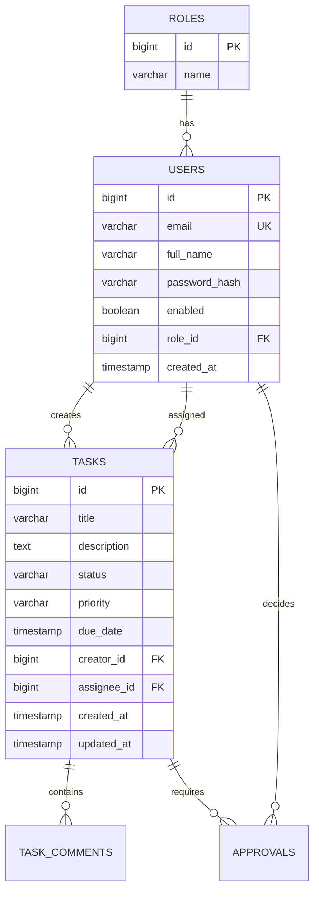

# TaskFlow 

> **TaskFlow** — современный RESTful API сервис управления задачами и согласованиями с Event-Driven архитектурой аудита на базе Apache Kafka.

Проект построен на **Java 21** и **Spring Boot 4**, ориентирован на высокие стандарты корпоративной разработки: строгая типизация (Java Records), отсутствие Lombok, безопасность на Spring Security 6 + JWT, версионирование схемы БД через Liquibase и асинхронный аудит через Kafka (KRaft).

---

##  Стек технологий

| Технология | Назначение |
|---|---|
| **Java 21** | Современный LTS синтаксис (Records, Pattern Matching) |
| **Spring Boot 4.1.1** | Основа приложения и управление зависимостями |
| **Spring Data JPA & Hibernate** | Слой персистентности и работа с БД |
| **Spring Security & JJWT (0.12.6)** | Аутентификация и авторизация (Stateless JWT Bearer) |
| **PostgreSQL 16** | Основная реляционная база данных |
| **Liquibase** | Миграции и версионирование структуры БД |
| **Apache Kafka 3.7.0 (KRaft)** | Event-Driven шина событий для аудита изменений задач |
| **Redis 7** | Кэширование данных сессий и быстрого доступа |
| **MapStruct 1.6.3** | Быстрый генератор маппинга DTO ↔ Entity на этапе компиляции |
| **SpringDoc OpenAPI (Swagger UI)** | Автодокументация REST API |
| **Docker & Docker Compose** | Локальная инфраструктура сервисов |

---

##  Архитектура и принципы разработки

* **No-Lombok Policy**: чистый и предсказуемый Java-код. Все DTO реализованы через `record`, сущности — через стандартные POJO с явным контролем инкапсуляции.
* **Constructor Dependency Injection**: явное внедрение зависимостей без скрытой магии через аннотации полей.
* **Database-First Schema**: Hibernate работает в режиме `ddl-auto: validate`. Вся структура таблиц, индексов и связей управляется исключительно через Liquibase changelog XML.
* **Event-Driven Audit**: ключевые операции над задачами (создание, изменение статуса, назначение) отправляют события `TaskEvent` в топик `task-events` Kafka. Консьюмер асинхронно логирует и сохраняет историю в `audit_logs`.

---

##  Быстрый старт

### 1. Требования
* **JDK 21** (например, Eclipse Temurin / OpenJDK 21)
* **Docker Desktop** (с поддержкой Docker Compose)
* **Git**

### 2. Клонирование репозитория
```bash
git clone https://github.com/your-username/TaskFlow.git
cd TaskFlow
```

### 3. Запуск инфраструктуры (БД, Redis, Kafka)
В корне проекта выполните:
```bash
docker compose up -d
```

Контейнеры поднимут следующие сервисы:
* **PostgreSQL**: `localhost:5433` (внутри контейнера `5432`, БД: `taskflow`, юзер: `taskflow_user`, пароль: `taskflow_pass`)
* **Redis**: `localhost:6379`
* **Kafka (KRaft)**: `localhost:9092`

> [!NOTE]
> Если ваше приложение подключается к PostgreSQL напрямую через порт хоста, убедитесь, что порт в `application.yml` соответствует замапленному в Docker Compose (`5433` или `5432`).

### 4. Сборка и запуск приложения
```bash
# Windows
.\mvnw clean spring-boot:run

# Linux / macOS
./mvnw clean spring-boot:run
```

После старта Liquibase автоматически применит все актуальные миграции и сиды ролей.

---

##  Документация API (Swagger UI)

После запуска приложения интерактивная документация доступна по адресу:
* **Swagger UI**: [http://localhost:8080/swagger-ui.html](http://localhost:8080/swagger-ui.html)
* **OpenAPI Docs**: [http://localhost:8080/api-docs](http://localhost:8080/api-docs)

---

##  Основные эндпоинты

### Аутентификация (`/api/v1/auth`)
* `POST /api/v1/auth/register` — регистрация нового сотрудника (роль по умолчанию: `EMPLOYEE`).
* `POST /api/v1/auth/login` — аутентификация пользователя, возвращает JWT Bearer токен.

### Задачи (`/api/v1/tasks`)
* `POST /api/v1/tasks` — создать новую задачу (требуется JWT).
* `GET /api/v1/tasks/{id}` — получить задачу по ID.
* `GET /api/v1/tasks` — список всех задач.
* `PATCH /api/v1/tasks/{id}` — частичное обновление задачи (статус, исполнитель, описание).
* `DELETE /api/v1/tasks/{id}` — удалить задачу (HTTP 204 No Content).

---

## 🗄 Структура БД



---

##  Тестирование
```bash
# Запуск компиляции и модульных тестов
.\mvnw test
```
